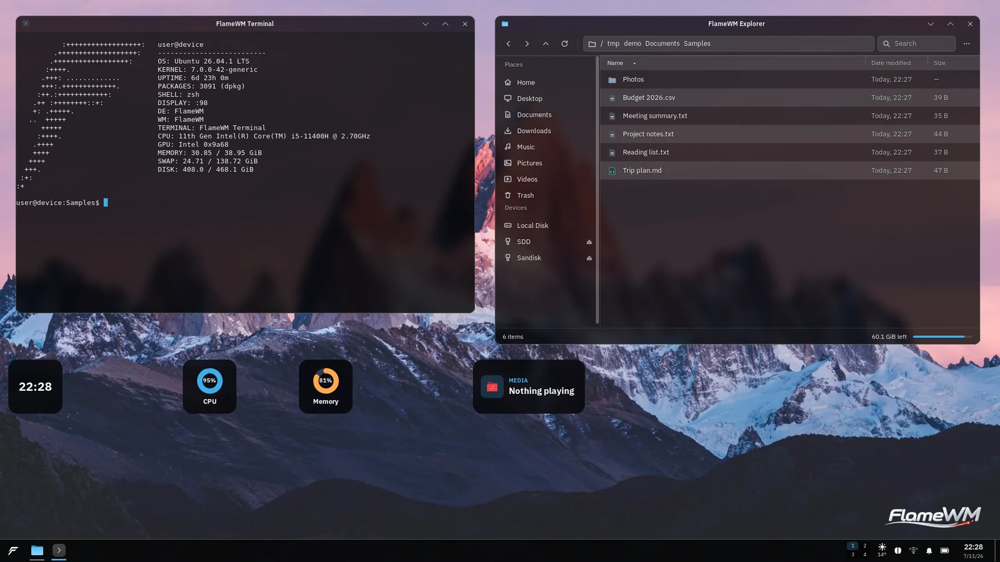
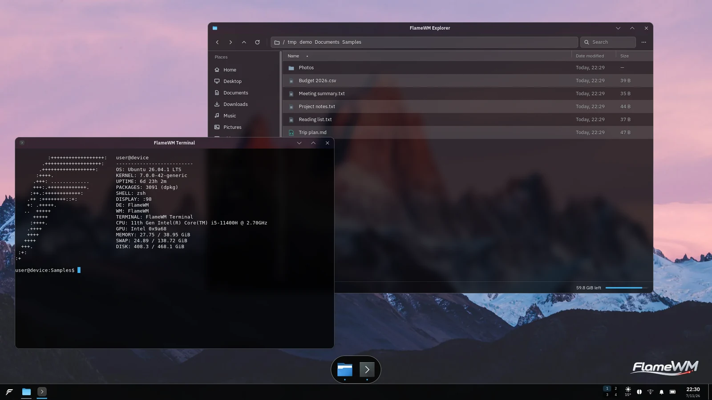
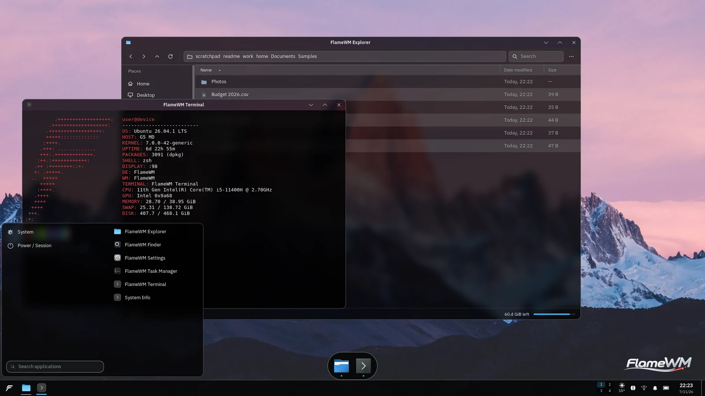

<div align="center">

# FlameWM

**A window manager and desktop shell for Linux, written in Rust, with its UI in HTML and CSS compiled to native code.**

No browser runtime. Two sessions: X11 (default) and Wayland (in development).

[](LICENSE)


[Screenshots](#screenshots) · [Features](#features) · [Status](#status) · [Install](#install) · [Build](#build-from-source) · [Architecture](docs/ARCHITECTURE.md) · [Contributing](#contributing)



</div>

---

## Why FlameWM

- **Native and small.** The shell is HTML and CSS, compiled at build time. There is no embedded browser. Idle figures are in [Performance](#performance).
- **One desktop, one owner per job.** The window manager, shell, settings, lock screen and apps are separate crates. The layering rules are in [`docs/ARCHITECTURE.md`](docs/ARCHITECTURE.md).
- **Honest status.** Open work is tracked in [`docs/TODO.md`](docs/TODO.md). Known issues are listed below, not hidden.

## Screenshots

| Explorer, Terminal and widgets | Start menu and Dock |
| --- | --- |
|  |  |

The screenshots come from an isolated FlameWM session on a private Xvfb display, with the default wallpaper, sample files and a neutral profile.

## Features

Status key: **Shipped** is in the current source and used in the screenshots. **Partial** is present with stated gaps. **Planned** is not yet built.

| Area | Feature | Status |
| --- | --- | --- |
| Window management (X11) | Reparenting, focus, minimize, maximize, fullscreen, move, resize | Shipped |
| Window management (X11) | Snap previews | Shipped |
| Window management (X11) | Keyboard-switched workspaces | Shipped |
| Desktop | Icons, context menus, wallpapers | Shipped |
| Panel | Taskbar, Start menu, status popovers, Dock (pill layout) | Shipped; Dock is partial, see [`docs/DOCK_DESIGN.md`](docs/DOCK_DESIGN.md) |
| Widgets | Clock, CPU, memory, media | Shipped |
| Settings | Settings application | Shipped |
| Lock screen | PAM authentication (X11) | Shipped on X11; not on Wayland |
| Screenshots | Full screen, monitor, window, region, annotation, clipboard, optional `ffmpeg` recording | Shipped; see [`docs/SCREENSHOT.md`](docs/SCREENSHOT.md) |
| Audio | Volume on-screen display for XF86 audio keys | Shipped |
| Apps | Task manager, terminal, file explorer, finder | Shipped |
| Weather | Open-Meteo popup | Shipped; off by default, needs network |
| ARK AI | Optional ARK AI chat window | Shipped; off by default, see [ARK AI](#ark-ai) |
| Wayland | Compositor on Smithay, runs native Wayland and XWayland clients | Partial; see [Wayland known issues](#wayland-known-issues) |
| Wayland | DRM/KMS backend | Partial; no successful native login on record |
| Wayland | Nested development backend | Shipped |
| Displays | Per-output layout and scale | Planned |

Full comparison with another desktop is in [`docs/competitors/`](docs/competitors/README.md).

## Status

FlameWM is a source-level release. It does not claim parity with the historical IceWM or C implementations. Release history is in [`CHANGELOG.md`](CHANGELOG.md). The current version is printed by `./scripts/version`.

No installed session has been accepted on real hardware in this revision. See [`docs/INSTALL.md`](docs/INSTALL.md) and [`docs/PACKAGING.md`](docs/PACKAGING.md).

## Sessions

| Session | Entry | Notes |
| --- | --- | --- |
| FlameWM (X11) | `/usr/share/xsessions/flamewm.desktop` | Default. |
| FlameWM (Wayland) | `/usr/share/wayland-sessions/flamewm-wayland.desktop` | Native DRM/KMS, or a nested window for development. |

The Wayland compositor is `crates/flamewm-wm-wayland`, built on Smithay. It runs native Wayland clients and XWayland. The shell, desktop and settings run as XWayland clients. Install from a working X11 session first. If the Wayland session fails, choose **FlameWM** at the login screen. The wrapper does not fall back to X11 by itself.

Diagnostics:

```bash
flamewm-wayland --capabilities                  # build facts only
flamewm-wayland --probe                         # read-only report
tail -n 200 ~/.cache/flamewm/wayland-session.log
```

### Wayland known issues

- No successful native DRM login is on record. One reported login fails after the cursor appears.
- No session lock, screenshot portal, per-output layout or per-output scale.
- At the default 80% terminal opacity the terminal body renders black. It renders correctly at `background_opacity = 100`.

The full status is in [`docs/WAYLAND_PLAN.md`](docs/WAYLAND_PLAN.md).

## ARK AI

The ARK AI assistant is an optional chat window. It is off by default.

1. Open **Settings > ARK AI** and enable it. Super+C and Ctrl+Alt+C are grabbed only while it is enabled.
2. Press Super+C or Ctrl+Alt+C. The assistant uses the shared public ARK AI key by default. Set your own key (starts with `ark_`) in Settings > ARK AI.
3. Optional: a Hermes model proxy on `127.0.0.1:8645` is detected automatically and listed as its own group in the model menu. FlameWM does not install or start it.

Voice is optional. The assistant window can run a one-click setup that creates a private Python virtual environment and downloads the speech models. See [`docs/INSTALL.md`](docs/INSTALL.md#assistant-speech-optional) and [the proxy provider](docs/ASSISTANT.md).

## Keyboard shortcuts

Defaults come from `crates/flamewm-platform/src/shortcuts.rs`. All bindings can be changed in Settings.

| Action | Default |
| --- | --- |
| Toggle Start menu | `Super_L` (bare tap) |
| Open ARK AI | `Super+C` or `Ctrl+Alt+C` (only when enabled) |
| Switch workspace left / right | `Ctrl+Super+Left` / `Ctrl+Super+Right` |
| Switch workspace up / down | `Ctrl+Super+Up` / `Ctrl+Super+Down` |
| Close window | `Alt+F4` |
| Lock session | `Super+L` |
| Screenshot, all screens | `Print` |
| Screenshot, region with annotation | `Shift+Print` |
| Screenshot, active window | `Ctrl+Print` |
| Volume up / down / mute | `XF86AudioRaiseVolume` / `XF86AudioLowerVolume` / `XF86AudioMute` |
| Minimize / maximize window | unassigned |

## Configuration

- Settings file, first match wins:
  1. `FLAMEWM_SETTINGS_PATH`;
  2. `$FLAMEWM_CONFIG_DIR/settings.toml`;
  3. `$XDG_CONFIG_HOME/flamewm/settings.toml` (default `~/.config/flamewm/settings.toml`).
- Wallpapers: `$XDG_DATA_HOME/flamewm/wallpapers` (default `~/.local/share/flamewm/wallpapers`).
- Installed read-only assets: `/usr/share/flamewm/`.

## Install

Tagged versions attach the Arch package and the `.deb` to the [GitHub releases](https://github.com/ArkFlame/FlameWM/releases). To build your own package, see [Packaging](#packaging).

Debian and Ubuntu:

```bash
sudo dpkg -i .target/dist/flamewm_<version>_amd64.deb
sudo dpkg -r flamewm                       # uninstall
```

Arch Linux:

```bash
./scripts/build-arch --syncdeps
sudo pacman -U .target/arch/packages/flamewm-git-<pkgver>-1-x86_64.pkg.tar.zst
sudo pacman -R flamewm-git                 # uninstall
```

### Packaging

`./scripts/package` writes the archives and, when `dpkg-deb` is available, the `.deb` to `.target/dist/`. File names follow the version from `./scripts/version`. Details are in [`docs/PACKAGING.md`](docs/PACKAGING.md).

## Build from source

Install the development dependencies:

```bash
./scripts/install-deps-ubuntu.sh   # Debian and Ubuntu
./scripts/install-deps-arch.sh     # Arch Linux
```

Then, from the repository root:

```bash
./scripts/doctor     # environment and library checks
./scripts/check      # build and native checks
./scripts/xephyr     # run FlameWM in a nested Xephyr display
```

`./scripts/release-gate` runs `check` and `package` and verifies checksums. It does not run `xephyr` or `verify-visual`, which must be run separately.

Headless visual checks need `xf86-video-dummy`, `xdotool`, ImageMagick, `xterm` and `python-xlib`:

```bash
./scripts/verify-visual
python3 -I tools/flamewm_visual_tests.py --bin-dir .target/release --out .target/visual
```

Wayland development:

```bash
./scripts/build-deb                        # release build with DRM support
flamewm-wayland --backend=nested           # nested window in your current session
```

Performance numbers come from release builds only. Debug builds are not evidence.

## Performance

Measured 2026-10-30 on a nested Xephyr display on a shared machine. Treat these as noisy samples. The binaries were built 2026-10-29 and do not all match commit `c58954af`.

| Idle session, FlameWM-owned processes, no apps open | RSS MiB | PSS MiB |
| --- | --- | --- |
| Session mode (supervisor, WM, audio helper, desktop, shell) | 57.4 | 23.8 |
| Direct mode (WM, desktop, shell) | 58.9 | 26.9 |

Scope of both rows:

- nested Xephyr display at 1280x800, not an installed session;
- FlameWM processes only, **Xephyr excluded**, so server-side pixmaps are not in the numbers;
- no applications open;
- `flamewm-desktop-services`, the Python session companion, was not running and is not in either total;
- single idle snapshot each, PSS and RSS as labelled.

These are component figures, not a whole-session figure and not a comparison against another desktop. No other desktop is measured here, so these numbers do not support a "fastest" or "lightest" claim.

Reproduce:

```bash
BENCH_DISPLAY=:166 tools/bench_mem.sh idle                  # per-process listing (above)
tools/bench_mem.sh --explain                                # include/exclude manifest
cargo run --release -p flamewm-render-x11 --example pixel_bench
```

Method, scope and full tables: [`docs/PERFORMANCE.md`](docs/PERFORMANCE.md#benchmark).

## Architecture

FlameWM is a Cargo workspace of about 57 crates. The main groups:

- **Window managers:** `flamewm-wm-x11`, `flamewm-wm-wayland`, `flamewm-wm`.
- **Shell and UI:** `flamewm-shell`, `flamewm-shell-core`, `flamewm-ui`, `flamewm-ui-core`, `flamewm-widgets-core`.
- **Rendering:** `flamewm-render-core`, `flamewm-render-x11`, `flamewm-render-compiler`.
- **Desktop apps:** `flamewm-desktop`, `flamewm-explorer`, `flamewm-terminal`, `flamewm-settings`, `flamewm-task-manager`, `flamewm-screenshot`, `flamewm-lock`.
- **Platform and events:** `flamewm-platform`, `flamewm-reactor`, `flamewm-integrations-linux`.

The ownership rules (one owner per mechanism, typed facades, no UI authority over the window manager) are in [`docs/ARCHITECTURE.md`](docs/ARCHITECTURE.md).

## Documentation

- [`docs/ARCHITECTURE.md`](docs/ARCHITECTURE.md): crate layout and ownership rules.
- [`docs/INSTALL.md`](docs/INSTALL.md), [`docs/PACKAGING.md`](docs/PACKAGING.md): installation and packaging.
- [`docs/WAYLAND_PLAN.md`](docs/WAYLAND_PLAN.md): Wayland implementation and open work.
- [`docs/PERFORMANCE.md`](docs/PERFORMANCE.md): performance contract and measurements.
- [`docs/DEVELOPMENT.md`](docs/DEVELOPMENT.md), [`docs/VERIFICATION.md`](docs/VERIFICATION.md): development and verification gates.
- [`docs/competitors/`](docs/competitors/README.md): competitor tracking, with feature and design comparisons.
- [`docs/history/`](docs/history/): dated reports from earlier development.
- [`CHANGELOG.md`](CHANGELOG.md), [`SECURITY.md`](SECURITY.md).

## Contributing

Read [`CONTRIBUTING.md`](CONTRIBUTING.md) first, then [`docs/DEVELOPMENT.md`](docs/DEVELOPMENT.md). The build and native checks are `./scripts/check`. Use [`docs/VERIFICATION.md`](docs/VERIFICATION.md) for the gates that apply to your change. For security reports, follow [`SECURITY.md`](SECURITY.md).

## License

FlameWM is licensed under LGPL-2.0-only. See [`LICENSE`](LICENSE) and `workspace.package.license` in [`Cargo.toml`](Cargo.toml).

One exception is pending: `crates/flamewm-render-compiler` declares MIT and ships [`LICENSES/RustWebRender-MIT.txt`](LICENSES/RustWebRender-MIT.txt). The maintainer has not confirmed its license.

<sub>Star history: [star-history.com](https://www.star-history.com/?repos=arkflame%2Fflamewm&type=date&legend=top-left)</sub>
