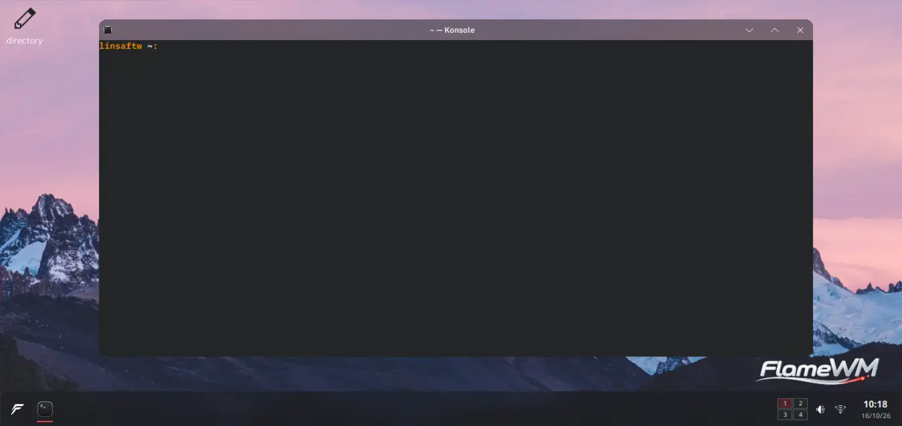

# FlameWM

FlameWM is a clean-room, X11-only window manager and desktop shell written in Rust. The shell UI is authored as HTML/CSS and compiled at build time into native Rust rendering, with no browser runtime.

FlameWM supports **X11 sessions only**. Wayland is not supported.

Version and release history: [`Cargo.toml`](Cargo.toml) (`workspace.package.version`), and [`CHANGELOG.md`](CHANGELOG.md).

## Status

- Source-level release. Remaining product surfaces are tracked in [`docs/TODO.md`](docs/TODO.md).
- FlameWM does not claim parity with the historical IceWM or FlameWM C implementations.
- Memory has been measured on a development machine only; see [Memory](#memory) for exactly what was and was not measured. The performance contract is in [`docs/PERFORMANCE.md`](docs/PERFORMANCE.md).

## Features

- X11 window manager with reparenting, focus and activation, minimize/maximize/fullscreen, interactive move and resize, and snap previews (`crates/flamewm-wm`, `crates/flamewm-wm-x11`).
- Virtual workspaces with keyboard switching.
- Desktop with icons, context menus, and wallpaper loading (`crates/flamewm-desktop`, `crates/flamewm-integrations-linux`).
- Panel, Start menu, and status popovers rendered by the shell (`crates/flamewm-shell`).
- Settings application with typed settings transactions across the platform services (`crates/flamewm-settings`, `crates/flamewm-platform`).
- Lock screen with PAM authentication (`crates/flamewm-lock`, `packaging/pam.d/flamewm-lock`).
- Native FlameWM Screenshot tool: X11 full/monitor/window/region capture, PNG saving, image/png clipboard, interactive pen/shape/arrow/redaction annotations, and optional ffmpeg screen recording (`crates/flamewm-screenshot`).
- Volume on-screen display driven by the XF86 audio keys.
- Weather popup with Open-Meteo forecast and location search. Requires network access; the Open-Meteo free tier is for noncommercial use only; attribution is shown in the popup. Disabled by default.

## X11 limitations

- X11 session only. There is no Wayland or XWayland-independent compositor path.
- Requires X11, Xft, and Fontconfig runtime libraries.
- The renderer crate (`crates/flamewm-render-x11`) is the explicit Xlib/Xft FFI boundary; the window manager itself uses safe `x11rb` protocol APIs.
- FlameWM does not replace a display manager. Select it from the session chooser after installation.
- Multi-output (two-output RandR) layouts have not been tested.
- Wayland: see [`docs/WAYLAND_BACKEND_FEASIBILITY.md`](docs/WAYLAND_BACKEND_FEASIBILITY.md). Feasibility analysis only; no Wayland support exists.

## Default shortcuts

The defaults below come from `crates/flamewm-platform/src/shortcuts.rs` (`ShortcutRegistry::default`). Bindings are configurable through settings.

| Action | Default |
| --- | --- |
| Toggle Start menu | `Super_L` (left Super, bare tap) |
| Switch workspace left / right | `Ctrl+Super+Left` / `Ctrl+Super+Right` |
| Switch workspace up / down | `Ctrl+Super+Up` / `Ctrl+Super+Down` |
| Close window | `Alt+F4` |
| Lock session | `Super+L` |
| All screens screenshot | `Print` |
| Capture and annotate region | `Shift+Print` |
| Active window screenshot | `Ctrl+Print` |
| Volume up / down / mute | `XF86AudioRaiseVolume` / `XF86AudioLowerVolume` / `XF86AudioMute` |
| Minimize / maximize window | unassigned |

## Screenshots and screen recording

Screenshots launch on demand; there is no always-running capture daemon. Use the
**FlameWM Screenshot** launcher or the default shortcuts above. PNGs are saved
under the XDG Pictures directory in `Screenshots/` (or `~/Pictures/Screenshots`)
and copied to CLIPBOARD when invoked from a hotkey. Saving never overwrites an
existing path. The clipboard owner remains idle and exits automatically when
another program replaces the clipboard.

```bash
flamewm-screenshot --region --annotate --copy
flamewm-screenshot --full --output ~/Pictures/desktop.png
flamewm-screenshot --screen --no-save --copy
flamewm-screenshot --window --delay 2 --copy
flamewm-screenshot --region --record 15 --fps 30
```

The native annotation toolbar supports `P` freehand, `L` line, `R` rectangle,
`E` ellipse, `A` arrow, `X` black redaction, `C` cycle color, `U` undo,
`Enter` save and `Escape` cancel. The editor is an X11 window, not a web view.
Recording requires `ffmpeg` with X11grab and H.264 encoding; no recording
process runs while the feature is unused. X11 captures visible screen pixels;
obscured windows are not independently redirected. Wayland capture is not
supported. Text annotations, OCR, recording audio, advanced video editing and
Spectacle/KDE DBus API compatibility are not currently implemented.

## Configuration locations

- Settings file, resolved in this order (`settings_path` in `crates/flamewm-wm-x11/src/runtime.rs`):
  1. `FLAMEWM_SETTINGS_PATH` (exact file path);
  2. `$FLAMEWM_CONFIG_DIR/settings.toml`;
  3. `$XDG_CONFIG_HOME/flamewm/settings.toml`, or `~/.config/flamewm/settings.toml` when `XDG_CONFIG_HOME` is unset.
- Wallpapers: `$XDG_DATA_HOME/flamewm/wallpapers` (default `~/.local/share/flamewm/wallpapers`), per `crates/flamewm-integrations-linux/src/media_store.rs`.
- Installed read-only assets: `/usr/share/flamewm/` (see `packaging/install-manifest.txt`).

## Build and development

Ubuntu/Debian development dependencies:

```bash
./scripts/install-deps-ubuntu.sh
```

Then, from the repository root:

```bash
./scripts/doctor        # environment and library checks
./scripts/check         # build and native checks
./scripts/xephyr        # run FlameWM inside a nested Xephyr display
```

Packaging and release gates:

```bash
./scripts/package       # packaging only; does not run Cargo or tests
./scripts/release-gate  # runs ./scripts/check and ./scripts/package and verifies checksums; does NOT run ./scripts/xephyr or ./scripts/verify-visual
```

The interactive contract is a release build. Debug builds are not accepted as product performance evidence.

Visual comparison (`./scripts/verify-visual`) and the other acceptance scripts under `scripts/` and `tools/` are separate gates and must be run explicitly.

## Install, upgrade, and uninstall

`./scripts/package` writes the Linux archive, the source archive, and, when `dpkg-deb` is available, the `.deb` under `.target/dist/` (file names follow the workspace version printed by `scripts/version`; for example `flamewm_<version>_amd64.deb`). See [`docs/INSTALL.md`](docs/INSTALL.md) and [`docs/PACKAGING.md`](docs/PACKAGING.md).

**The installed `.deb` (install, upgrade, uninstall) has not been run in this revision.** The steps below are documented from `scripts/package` and `packaging/debian/control.in`; they are not verified acceptance.

Install:

```bash
sudo dpkg -i .target/dist/flamewm_<version>_amd64.deb
```

Upgrade: install a newer `flamewm_*_amd64.deb` with the same `dpkg -i` command.

Uninstall:

```bash
sudo dpkg -r flamewm
```

Without `dpkg` (not tested), the Linux archive can be unpacked as root. Its entries are prefixed `flamewm-<version>/`, so strip that component:

```bash
tar -xzf .target/dist/flamewm-<version>-linux-x86_64.tar.gz --strip-components=1 -C /
```

## Memory

Measured on a private Xephyr display. Five paired release runs each of an older build and the current build:

- Combined WM + Shell idle RSS: median about 30.7 MB (older build) and 31.1 MB (current build); maximum 31.23 MB.
- All 10 runs were under the 34 MiB (35,651,584 B) target.
- PSS about 14.7 MB.
- The current build is not measurably smaller than the older build.
- Not included: the desktop process (about 44 MB RSS) and X server memory.
- Not measured: real Xorg, frame p95, and full-session numbers.

## Crate architecture

Crate roles are taken from the workspace `Cargo.toml` manifests. Layering rules are in [`docs/ARCHITECTURE.md`](docs/ARCHITECTURE.md):

| Crate | Role |
| --- | --- |
| `crates/flamewm-wm` | Binary `flamewm`; X11 window manager authority, built on `flamewm-wm-x11` |
| `crates/flamewm-wm-x11` | X11 window manager library (`x11rb`): client discovery, frames, focus, workspaces, snap geometry |
| `crates/flamewm-platform` | Product services and policy (settings, shortcuts) |
| `crates/flamewm-*-core` | Pure product models (for example `flamewm-settings-core`, `flamewm-shell-core`) |
| `crates/flamewm-shell` | V8 shell controller: panel, Start, popovers |
| `crates/flamewm-settings` | Settings application |
| `crates/flamewm-lock` | Lock screen core (PAM, settings, lock state) |
| `crates/flamewm-render-compiler` | Build-time HTML/CSS compiler to RWRB/2 |
| `crates/flamewm-render-x11` | Xlib/Xft native renderer and FFI boundary |
| `crates/flamewm-reactor` | Native event sources |
| `crates/flamewm-x11-canary` | X11 acceptance scenario binary |

The `.vendor/` directory holds historical reference corpora only. No active crate may include, link, or load `.vendor/**`.

## Licensing

- The workspace package license in [`Cargo.toml`](Cargo.toml) (`workspace.package.license`) is `LGPL-2.0-only`; the full text is in [`LICENSE`](LICENSE). [`packaging/debian/copyright`](packaging/debian/copyright) also declares LGPL-2.0-only.
- **Known mismatch:** `crates/flamewm-render-compiler/Cargo.toml` declares `license = "MIT"` and [`LICENSES/RustWebRender-MIT.txt`](LICENSES/RustWebRender-MIT.txt) contains MIT text, while the rest of the workspace is LGPL-2.0-only. The license for that crate is pending maintainer confirmation; this README does not resolve it.
- Third-party notices and icon/theme licenses are in [`LICENSES/`](LICENSES/). Weather data attribution (Open-Meteo, CC BY 4.0): [`LICENSES/Open-Meteo-CC-BY-4.0.txt`](LICENSES/Open-Meteo-CC-BY-4.0.txt).

## Documentation

- [`CHANGELOG.md`](CHANGELOG.md): release history.
- [`docs/INSTALL.md`](docs/INSTALL.md), [`docs/PACKAGING.md`](docs/PACKAGING.md): install and packaging.
- [`docs/ARCHITECTURE.md`](docs/ARCHITECTURE.md): product boundary and ownership.
- [`docs/PERFORMANCE.md`](docs/PERFORMANCE.md): performance contract and targets.
- [`CONTRIBUTING.md`](CONTRIBUTING.md), [`SECURITY.md`](SECURITY.md).
