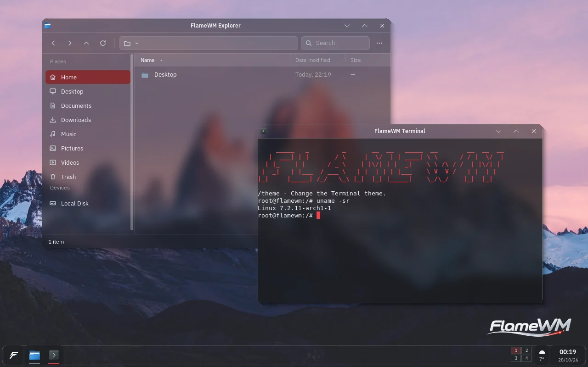
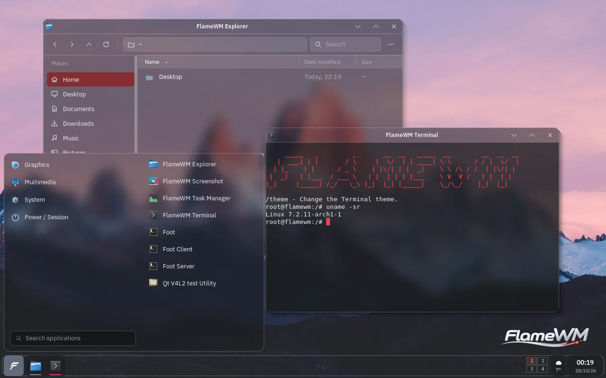

# FlameWM

FlameWM is a window manager and desktop shell written in Rust. The shell UI is written in HTML/CSS and compiled at build time into native rendering code. There is no browser runtime.

The package ships two sessions: **FlameWM** on X11 (the default) and **FlameWM (Wayland)**.

| Explorer and Terminal | Start menu |
| --- | --- |
|  |  |

The screenshots come from the headless test session (`tools/flamewm_visual_tests.py`) on Xorg's dummy driver.

## Status

FlameWM is a source-level release. Open work is tracked in [`docs/TODO.md`](docs/TODO.md). It does not claim parity with the historical IceWM or C implementations.

The current version is printed by `./scripts/version`. Release history is in [`CHANGELOG.md`](CHANGELOG.md).

## Sessions

| Session | Entry | Notes |
| --- | --- | --- |
| FlameWM (X11) | `/usr/share/xsessions/flamewm.desktop` | Default. |
| FlameWM (Wayland) | `/usr/share/wayland-sessions/flamewm-wayland.desktop` | Native DRM/KMS, or a nested window for development. |

The Wayland compositor is `crates/flamewm-wm-wayland`, built on Smithay. It runs native Wayland clients and XWayland. The shell, desktop and settings run as XWayland clients. Install from a working X11 session first. If the Wayland session fails, choose **FlameWM** at the login screen. The wrapper does not fall back to X11 by itself.

Diagnostics:

```bash
flamewm-wayland --capabilities                  # build facts only
flamewm-wayland --probe                         # read-only report
tail -n 200 ~/.cache/flamewm/wayland-session.log
```

### Wayland known issues

- No successful native DRM login is on record. One reported login fails after the cursor appears.
- No session lock, screenshot portal, per-output layout or per-output scale.
- At the default 80% terminal opacity the terminal body renders black. It renders correctly at `background_opacity = 100`.

The full status is in [`docs/WAYLAND_PLAN.md`](docs/WAYLAND_PLAN.md).

## Features

- X11 window manager: reparenting, focus, minimize, maximize, fullscreen, move and resize, snap previews, and keyboard-switched workspaces.
- Wayland compositor with a DRM/KMS backend and a nested development backend.
- Desktop with icons, context menus and wallpapers.
- Panel, Start menu and status popovers.
- Settings application.
- Lock screen with PAM authentication.
- Screenshot tool: full screen, monitor, window or region capture, annotation, clipboard, and optional `ffmpeg` recording. See [`docs/SCREENSHOT.md`](docs/SCREENSHOT.md).
- Volume on-screen display for the XF86 audio keys.
- Task manager.
- Weather popup using Open-Meteo. It is disabled by default and needs network access. The Open-Meteo free tier is for noncommercial use, and the popup shows attribution.
- FlameWM Assistant (below).

## FlameWM Assistant

The assistant is an optional ARK AI chat window. It is off by default.

1. Open **Settings > Assistant** and enable it. Super+C and Ctrl+Alt+C are grabbed only while it is enabled.
2. Press Super+C or Ctrl+Alt+C. The assistant uses the shared public ARK AI key by default. Set your own key (starts with `ark_`) in Settings > Assistant.
3. Optional: a Hermes model proxy on `127.0.0.1:8645` is detected automatically and listed as its own group in the model menu. FlameWM does not install or start it.

Voice is optional. The assistant window can run a one-click setup that creates a private Python virtual environment and downloads the speech models. See [`docs/INSTALL.md`](docs/INSTALL.md#assistant-speech-optional) and [the proxy provider](docs/ASSISTANT.md).

## Keyboard shortcuts

Defaults come from `crates/flamewm-platform/src/shortcuts.rs`. All bindings can be changed in Settings.

| Action | Default |
| --- | --- |
| Toggle Start menu | `Super_L` (bare tap) |
| Open assistant | `Super+C` or `Ctrl+Alt+C` (only when enabled) |
| Switch workspace left / right | `Ctrl+Super+Left` / `Ctrl+Super+Right` |
| Switch workspace up / down | `Ctrl+Super+Up` / `Ctrl+Super+Down` |
| Close window | `Alt+F4` |
| Lock session | `Super+L` |
| Screenshot, all screens | `Print` |
| Screenshot, region with annotation | `Shift+Print` |
| Screenshot, active window | `Ctrl+Print` |
| Volume up / down / mute | `XF86AudioRaiseVolume` / `XF86AudioLowerVolume` / `XF86AudioMute` |
| Minimize / maximize window | unassigned |

## Configuration

- Settings file, first match wins:
  1. `FLAMEWM_SETTINGS_PATH`;
  2. `$FLAMEWM_CONFIG_DIR/settings.toml`;
  3. `$XDG_CONFIG_HOME/flamewm/settings.toml` (default `~/.config/flamewm/settings.toml`).
- Wallpapers: `$XDG_DATA_HOME/flamewm/wallpapers` (default `~/.local/share/flamewm/wallpapers`).
- Installed read-only assets: `/usr/share/flamewm/`.

## Build

Install the development dependencies:

```bash
./scripts/install-deps-ubuntu.sh   # Debian and Ubuntu
./scripts/install-deps-arch.sh     # Arch Linux
```

Then, from the repository root:

```bash
./scripts/doctor     # environment and library checks
./scripts/check      # build and native checks
./scripts/xephyr     # run FlameWM in a nested Xephyr display
```

`./scripts/release-gate` runs `check` and `package` and verifies checksums. It does not run `xephyr` or `verify-visual`, which must be run separately.

Performance numbers come from release builds only. Debug builds are not evidence.

Headless visual checks need `xf86-video-dummy`, `xdotool`, ImageMagick, `xterm` and `python-xlib`:

```bash
./scripts/verify-visual
python3 -I tools/flamewm_visual_tests.py --bin-dir .target/release --out .target/visual
```

Wayland development:

```bash
./scripts/build-deb                        # release build with DRM support
flamewm-wayland --backend=nested           # nested window in your current session
```

## Packaging and installation

`./scripts/package` writes the archives and, when `dpkg-deb` is available, the `.deb` to `.target/dist/`. File names follow the version from `./scripts/version`.

Debian and Ubuntu:

```bash
sudo dpkg -i .target/dist/flamewm_<version>_amd64.deb
sudo dpkg -r flamewm                       # uninstall
```

Arch Linux:

```bash
./scripts/build-arch --syncdeps
sudo pacman -U .target/arch/packages/flamewm-git-<pkgver>-1-x86_64.pkg.tar.zst
sudo pacman -R flamewm-git                 # uninstall
```

Tagged versions attach the Arch package and the `.deb` to the [GitHub releases](https://github.com/ArkFlame/FlameWM/releases). No installed session has been accepted on real hardware in this revision. Details are in [`docs/INSTALL.md`](docs/INSTALL.md) and [`docs/PACKAGING.md`](docs/PACKAGING.md).

## Benchmark

Measured 2026-10-30 on a nested Xephyr display on a shared machine. Treat these as noisy samples. The binaries were built 2026-10-29 and do not all match commit `c58954af`.

| Idle session, Flame-owned processes, no apps open | RSS MiB | PSS MiB |
| --- | --- | --- |
| Session mode (supervisor, WM, audio helper, desktop, shell) | 57.4 | 23.8 |
| Direct mode (WM, desktop, shell) | 58.9 | 26.9 |

```bash
cargo run --release -p flamewm-render-x11 --example pixel_bench
BENCH_DISPLAY=:166 tools/bench_mem.sh idle     # on a running Xephyr session
```

Method and full tables: [`docs/PERFORMANCE.md`](docs/PERFORMANCE.md#benchmark).

## Documentation

- [`docs/ARCHITECTURE.md`](docs/ARCHITECTURE.md): crate layout and ownership rules.
- [`docs/INSTALL.md`](docs/INSTALL.md), [`docs/PACKAGING.md`](docs/PACKAGING.md): installation and packaging.
- [`docs/WAYLAND_PLAN.md`](docs/WAYLAND_PLAN.md): Wayland implementation and open work.
- [`docs/PERFORMANCE.md`](docs/PERFORMANCE.md): performance contract and measurements.
- [`docs/DEVELOPMENT.md`](docs/DEVELOPMENT.md), [`docs/VERIFICATION.md`](docs/VERIFICATION.md): development and verification gates.
- [`docs/history/`](docs/history/): dated reports from earlier development.
- [`CHANGELOG.md`](CHANGELOG.md), [`CONTRIBUTING.md`](CONTRIBUTING.md), [`SECURITY.md`](SECURITY.md).

## License

FlameWM is licensed under LGPL-2.0-only. See [`LICENSE`](LICENSE) and `workspace.package.license` in [`Cargo.toml`](Cargo.toml).

One exception is pending: `crates/flamewm-render-compiler` declares MIT and ships [`LICENSES/RustWebRender-MIT.txt`](LICENSES/RustWebRender-MIT.txt). The maintainer has not confirmed its license.
